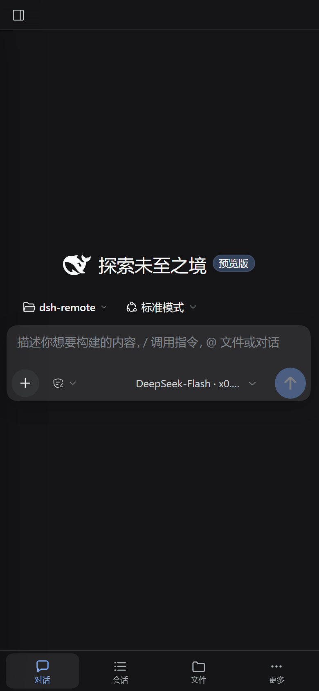

# dsh-remote

单管理员的局域网远程访问插件：手机/平板浏览器打开后，用管理员密码登录，直接操作这台电脑上的 DSH。没有成员账号、child host、工作区隔离、read guard 或模型网关。

本仓库是独立发布的插件。

## 它解决什么

DSH desktop 壳固定监听 `127.0.0.1`，并用启动 token 认证浏览器。本插件自带一个用户态反向代理 + 登录门：

- 随 DSH 启动，监听 `0.0.0.0:3080`，转发到 `127.0.0.1:52551`；
- 手机打开后先看到登录页，输入管理员账号密码；
- 登录一次后写 30 天会话 Cookie，之后免登录；
- 代理内部持有 DSH 启动 token，用它换 host-bound DSH Cookie；该 Cookie 只留在代理进程内存里，**不下发浏览器**；
- 手机拿到的是**同一个桌面 DSH** 的完整界面；窄屏远程页面自动切换为手机布局；
- 文件预览标题栏的「下载」按钮可下载原始产物（支持 Range，可拖动播放）；
- 右侧「文件」标签支持把文件拖到目录行上传；LAN 页面拖入聊天框也会上传字节，而不是插入 `C:\...` 本地路径。

## 与多账号插件的关系

本插件只提供「单管理员」形态。需要成员账号、child host、工作区隔离或模型网关时，请改用多账号形态的插件，**不要同时安装**：

- 两者都会占用 `0.0.0.0:3080`；
- 两者都会覆盖 `webserver`、`web-runtime` 的同一批配置行。

装本插件前，先用 DSH 自带的 CLI 把已安装的冲突插件卸掉：

    dsh plugin --profile desktop remove <已安装的多账号插件名>

## 安装

在 DSH 里用 Plugin Manager 安装本地目录：

    plugin_manager install_bundle target=E:\documents\Project\dsh-remote

或用桌面安装包自带的 CLI（不要用全局 npm 里的旧版 dsh）：

    & "%LOCALAPPDATA%\Programs\DeepSeek Harness\resources\runtime\cli\bin\dsh.cmd" plugin --profile desktop add E:\documents\Project\dsh-remote

安装后**必须**确认 profile 的 `package.json` 里：

1. `dependencies` 含 `dsh-remote`；
2. `dsh.profile.bundles` 里也含 `dsh-remote`，且排在 `@deepseek-ai/dsh-web-app` **之后**。

只有 dependencies 而没有 bundles 条目时，包会被安装但 patch 完全不生效。然后**完全退出 DSH 并重新启动**：bundle 只在启动时装配。

完整自检见 [docs/DEPLOYMENT.md](docs/DEPLOYMENT.md)。

## 首次登录与修改密码

如果还没有设置过密码，默认账号是：

    用户名：admin
    密码：dsh-remote

面板会提示「当前仍是默认密码」。请运行（不需要管理员）：

    E:\documents\Project\dsh-remote\scripts\set-remote-password.ps1

按提示输入用户名和密码（密码隐藏输入），脚本会把 scrypt 哈希写入
`%USERPROFILE%\.dsh\dsh-remote-auth.json`，然后重启 DSH。

也可以直接在 profile 的 dsh-remote config 里设置 username/password（明文，不推荐）。
优先级：`dsh-remote-auth.json` > config 的 username/password > 默认 admin/dsh-remote。

## 远程工作区操作

**目录选择器按来源分流。** 从手机页面点「添加工作区」，打开的是应用内目录浏览器：可以逐级进入、新建文件夹、直接选中当前目录。本机桌面窗口仍然用它原本的原生对话框，插件没有改动本地操作习惯。

实现上，LAN 页面会把 <code>uiWorkspace.pickDirectory</code> 换成应用内对话框，目录数据走 <code>/api/remote/browse</code>；<code>127.0.0.1</code> 的桌面窗口不替换。手机端不再需要先在电脑上预注册工作区，当然桌面预注册仍然可用。

右侧「文件」标签负责上传/浏览，和选择器无关。

「打开方式」是宿主动作，会在电脑上启动关联应用；LAN 页面会隐藏它，文件用预览标题栏的下载按钮取到手机。

没有工作区隔离：登录者就是桌面操作者，可以访问 PC 可读的任意目录。

文件上传：

- 右侧「文件」标签：把文件拖到目录行或文件树空白处，会流式写入该目录（`POST /api/remote/upload`，默认上限 512MB）；
- 聊天输入框：LAN 页面会移除 Electron 预加载的 `__DSH_HOST_PATHS__`，拖入文件走字节上传；本机 `127.0.0.1` 桌面窗口仍保留本地路径引用。

## 手机 UI

设置面板同样按手机重排：DSH 原生是「800px 面板 + 188px 左栏」，在 390px 视口里内容列只剩约 150px，卡片会被压成一字一行。插件把它改成上方横向标签条 + 下方全宽内容。

手机/平板打开 LAN 地址时，插件会给桌面 Web GUI 叠加一层移动端布局：

- **仅远程浏览器启用**：远程视口 ≤900px（粗指针设备放宽到 1180px）进入手机布局；本地 127.0.0.1/Electron 桌面窗口无论多窄都保持原生三栏；`?dshm=mobile` / `?dshm=desktop` 仅供调试强制；
- 这层样式依赖 DSH 自己的 DOM。插件启动时探测一次锚点表（`src/client/mobile/anchors.js`），**必需锚点缺失就不启用手机层**，保留桌面布局并写 `data-dshm-caps`——DSH 升级改了内部结构时，页面仍然可用，只是没有手机布局；
- 左侧栏变成全高抽屉，只保留工作区/会话一列；插件、自动化任务、回收站收进「更多」的工具卡；点会话后自动收起；
- 右侧「文件」变成全屏面板，底部导航可切回对话；
- 对话全宽、正文 15px、代码块 12.5px；主要触控目标 40–50px；
- 适配 `viewport-fit=cover` 和刘海/底部安全区；键盘弹出时底部导航让位；
- 插件管理器的「远程访问」总开关会重启 DSH 并切断代理页面，因此被拦截；请用远程访问面板里的「暂停/恢复」软开关：只暂停/恢复 3080 代理，不卸载插件、不重启 DSH；
- LAN 地址每次请求从快照读取（默认 5 秒刷新，可配 `lanSnapshotMs`），排除 169.254 链路本地地址；换 Wi-Fi 后无需改配置。

细节与排查见 [docs/MOBILE.md](docs/MOBILE.md)。

### 安卓 App

浏览器之外的原生入口（WebView 外壳：配对、原生登录、下载、文件选择、断线重连）见 [docs/ANDROID.md](docs/ANDROID.md)，含四屏线框图与 M1–M4 里程碑。M1 工程已落在 [android/](android/README.md)，可编译 debug APK；分享上传、生物识别和 SSE 通知属于 M2/M3。

## 开发

    要求 Node >= 22.19

    npm install
    npm run build        # src/client/** -> client.js
    npm run build:check  # CI：产物与源码不一致则失败
    npm test             # 73 个用例
    npm test:fast        # 受限沙箱下用（--test-isolation=none）
    npm run lint
    npm run typecheck
    npm run bench        # 代理热路径基准，p50 > 0.3 ms/req 则失败

客户端改动必须重新 `npm run build` 并提交 `client.js`——DSH 只加载这个产物。登录页和代理逻辑改动需要完全退出并重启 DSH。

设计取舍、Cookie 生命周期与失败行为见 [docs/DESIGN.md](docs/DESIGN.md)。

## 安全

- 登录者拥有与桌面 DSH 相同的权限：可读写 DSH 进程可访问的任意文件，没有成员隔离。
- 当前是明文 HTTP；同一局域网内的嗅探者可能拿到会话 Cookie。网络不可信时请用 Tailscale 或 TLS 终止代理。
- 登录失败 5 次/10 分钟后会临时限速（按来源地址，映射表有容量上限）。
- 会话 Cookie 是 HttpOnly、SameSite=Lax、30 天，签名绑定当前密码版本：改密码即吊销所有会话。
- DSH 启动 token 只在代理进程内存里，不写日志、不下发浏览器；上游 `dsh-auth-*` Cookie 在响应写回前被剔除。
- `/api/remote/download` 和 `/api/remote/upload` 使用 `/api/remote/*` 路径与独立的 `dsh-remote-session` Cookie。

## 自检

需要 DSH 正在运行：

    curl http://127.0.0.1:52551/api/remote/info
    curl http://127.0.0.1:52551/api/remote/pairing
    curl "http://127.0.0.1:52551/api/remote/download?path=..."

## 版本

见 [CHANGELOG.md](CHANGELOG.md)。
