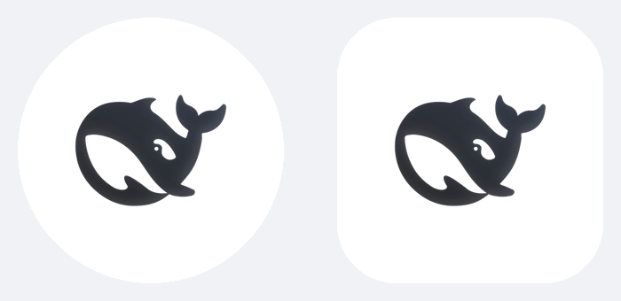

# DeepSeek Harness Android（M1）

DSH 局域网网关的 WebView 外壳。完整设计见 [../docs/ANDROID.md](../docs/ANDROID.md)。

## 已实现（M1）

- 主机列表、扫码 / 手输配对、登录前探活
- 原生登录：POST <code>/__dsh_remote/login</code>，会话值加密保存并注入 WebView Cookie
- WebView 加载 DSH 网页（手机布局仍由 <code>client.js</code> 提供）
- 系统下载（DownloadManager 带 Cookie）、文件选择（SAF）
- 返回键：先关抽屉 / Files，再后退，再双击退出
- 断线横条 + 网络恢复自动重载
- 设置：保持常亮、记住密码、清除会话

## 未实现

- 分享上传（M2）
- 生物识别（M2）
- SSE 通知（M3，需服务端 <code>/api/remote/events</code>）
- TLS 固定、mDNS 发现（M4）

## 环境

- JDK 17+（本机验证使用 JDK 25）
- Android SDK Platform 36 + Build-Tools 36.x
- Gradle 9.5.0（wrapper 已提交）
- AGP 9.3.3，**内置 Kotlin**：不要再应用 <code>org.jetbrains.kotlin.android</code>，否则构建会直接报错

## 构建

    cd android
    ./gradlew assembleDebug
    # 产物：app/build/outputs/apk/debug/app-debug.apk

安装：

    adb install -r app/build/outputs/apk/debug/app-debug.apk

单元测试：

    ./gradlew testDebugUnitTest

## 关键约束

- 明文 HTTP 只允许私网地址；配对入口会校验（<code>Urls.isPrivateHost</code>）。
- 会话 Cookie 是 HttpOnly，<code>CookieManager.getCookie()</code> 取不到。App 在登录响应里另存一份 Keystore 加密副本，供下载 / 上传使用。
- 首次运行要求电脑端 DSH 已启动，且 dsh-remote 代理在 3080 监听。

## 版本

- 启动名称：DeepSeek Harness
- 图标：DSH 的小虎鲸（自适应图标，白底；取自桌面端 <code>resources/icon.png</code>）
- App 0.1.0（versionCode 1）
- 服务端 dsh-remote 0.3.0

## 验证情况（2026-10）

已验证：

- <code>./gradlew assembleDebug</code> 成功，产出约 7 MB debug APK
- <code>./gradlew testDebugUnitTest</code>：7 个用例通过（地址规范化、私网判定、文件名解析）
- <code>./gradlew lintDebug</code>：0 error（56 条无害警告）
- Android 14 / Pixel 5 模拟器：启动、空状态、设置页、返回键、无崩溃
- 状态栏 insets：标题不再顶到状态栏；移动层在 Android 上不再使用 viewport-fit=cover
- 顶部空白：App 注入 <code>--dshm-safe-top/bottom: 0</code>（原生已按 system bar 留白）；mock 页故意设 80px 验证无空白（[截图](../docs/images/android-safearea-test.png)）
- 扫码页：固定竖屏，扫描线改为强调蓝（[截图](../docs/images/android-scanner.png)）
- 端到端（mock 网关）：原生登录 POST → 解析 Set-Cookie → 注入 CookieManager → WebView 加载受保护页面

未验证（需要真机 / 真实 DSH）：

- 真实 DSH 的登录与手机布局（本机密码已改，无法在模拟器里登录）
- 相机扫码配对
- 下载（DownloadManager + Cookie）、文件选择（SAF）
- 切网 / 换 Wi-Fi 的自动重连
- 深色模式（代码已配色，未截图）
