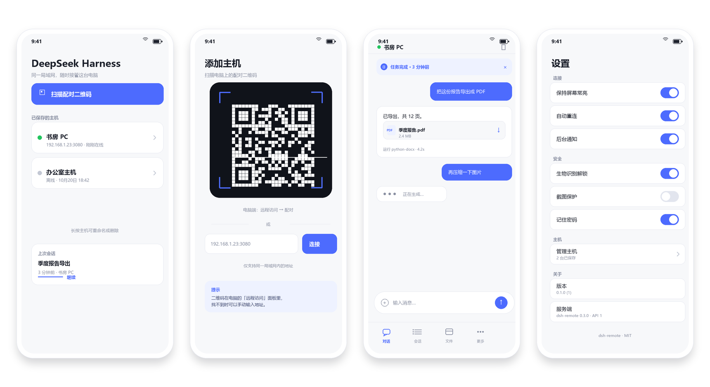
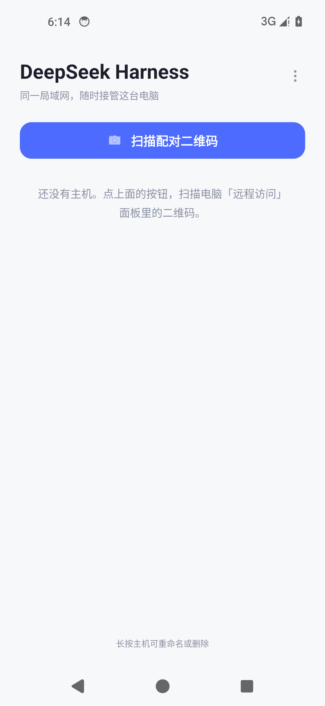
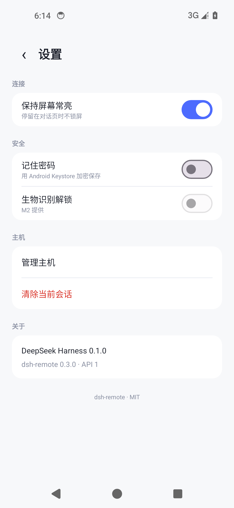

# 安卓 App 设计

一份「原生外壳 + 复用现有网页」的设计。App 不重写 DSH 的聊天界面，只补齐浏览器做不到的那部分：配对、凭据、连接生命周期、系统集成。

> **状态（2026-10）**：M1 已落地到 [android/](../android/README.md)，可编译出 debug APK；7 个 JVM 单元测试通过，Android Lint 0 error。已在 Android 14 / Pixel 5 模拟器上验证启动、设置页，以及「原生登录 → 写 Cookie → WebView 加载」全链路（用本地 mock 网关，真实 DSH 密码未知）。相机扫码、下载、文件选择、真实 DSH 页面尚未在真机验证；M2/M3 未实现。

运行截图（Android 14 / Pixel 5 模拟器）：

## 0. 结论

- **做原生外壳（WebView），不做原生重写，也不指望 PWA。**
- 理由很短：DSH 没有稳定的 GUI HTTP API，界面就是产品；而局域网明文 HTTP 下浏览器拿不到 Service Worker、安装提示和 Web Push，PWA 在安卓上只能是「快捷方式」，不是 App。
- App 的职责边界：**配对 / 登录 / 会话凭据 / 断线重连 / 下载上传 / 分享 / 通知 / 生物识别**。界面仍然是 DSH 自己的网页，手机布局仍由 <code>client.js</code> 的移动层负责。
- 底部导航、抽屉、Files 全屏面板、键盘避让**已经在网页层实现**，App 不要重复画一套。

## 1. 现状与硬约束

现有插件已经提供了 App 需要的全部服务端能力：

| 能力 | 位置 | 对 App 的意义 |
|---|---|---|
| 反向代理 <code>0.0.0.0:3080</code> → <code>127.0.0.1:52551</code> | <code>host/proxy/server.js</code> | App 唯一入口，不直连 DSH |
| 登录门 <code>GET/POST /__dsh_remote/login</code> | <code>host/auth/login-route.js</code> | 原生登录表单可以复用 |
| 30 天会话 <code>dsh-remote-session</code>（HttpOnly） | <code>host/auth/session.js</code> | WebView 持久化即可免登录 |
| 手机布局（抽屉 / 底栏 / Files） | <code>src/client/mobile/**</code> | App 内直接生效，无需重做 |
| 下载（Range / ETag / Content-Disposition） | <code>host/routes/download.js</code> | 交给系统 DownloadManager |
| 上传（流式，512MB） | <code>host/routes/upload.js</code> | 分享进来可直接 POST |
| 暂停 / 恢复代理 | <code>/api/remote/control</code> | App 内可做「断开」开关 |
| WebSocket 升级转发 | <code>host/proxy/server.js</code> | 实时更新可用 |

同时有四条绕不开的约束：

1. **明文 HTTP，没有 TLS。** 浏览器因此拿不到 Service Worker / Push / 安装提示；App 则必须显式允许 cleartext。
2. **DSH 只监听 <code>127.0.0.1</code>。** App 不能直连 52551，必须走 3080 代理。
3. **会话 Cookie 是 HttpOnly。** 网页 JS 读不到（这是对的）；<code>CookieManager.getCookie()</code> 也不会返回它。所以原生登录时要把 <code>Set-Cookie</code> 里的值另存一份（Keystore 加密），下载、上传、SSE 都用这份副本；WebView 里的 Cookie 仍然照常工作。
4. **手机布局依赖 DSH 的 DOM 锚点。** DSH 升级后可能降级成桌面布局；App 必须能接受「能用的桌面版」，而不是白屏。

## 2. 方案对比

| 维度 | PWA | **WebView 外壳（推荐）** | 原生重写 | TWA |
|---|---|---|---|---|
| 局域网明文 HTTP | ✗ 无 SW / 无安装提示 | ✓ | ✓ | ✗ 需 HTTPS + assetlinks |
| 免安装 | ✓ | ✗ 需装 APK | ✗ | ✗ |
| 通知 | ✗ | ✓ 本地通知（SSE） | ✓ | ✗ |
| 文件 / 分享 / 下载 | 浏览器默认 | ✓ 系统集成 | ✓ | 浏览器默认 |
| 生物识别 / Keystore | ✗ | ✓ | ✓ | ✗ |
| 升级风险 | 低 | **低**（界面仍是网页） | 极高 | 低 |
| 工作量 | 低 | 中（2–3 周） | 极高 | 低 |

结论：**WebView 外壳**。TWA 在明文 LAN 上直接出局；原生重写等于把 DSH 的 UI 抄一遍，每个版本都要追。

过渡方案：今天就能在 Chrome 里「添加到主屏幕」，得到一个快捷方式（仍在浏览器中打开），至少省掉每次输地址；但没有通知、没有原生文件/分享能力。

## 3. 架构

    ┌──────────────────────── Android App ────────────────────────┐
    │  Hosts / Pair / Settings（Compose，原生）                    │
    │  ┌──────────────────────────────────────────────────────┐   │
    │  │ WebView：DSH 网页 + client.js 手机层                   │   │
    │  │  （底部导航、抽屉、Files、键盘避让都在网页里）          │   │
    │  └──────────────────────────────────────────────────────┘   │
    │  SessionStore（Keystore）  Transfer（DownloadManager/SAF）   │
    │  EventService（SSE → 本地通知，M3）                          │
    └──────────────────────────────┬──────────────────────────────┘
                                   │ HTTP :3080（Cookie: dsh-remote-session）
                    ┌──────────────▼──────────────┐
                    │ dsh-remote 反向代理（已有）   │
                    └──────────────┬──────────────┘
                                   │ 127.0.0.1:52551
                    ┌──────────────▼──────────────┐
                    │ DSH 桌面 Web GUI（已有）      │
                    └─────────────────────────────┘

技术选型：

- Kotlin + Jetpack Compose（原生页）+ <code>AndroidView</code> 包 WebView。
- 协程 + Flow，手动依赖注入，不引入 Hilt/Room。
- OkHttp 负责登录探测、上传、SSE；WebView 负责界面。
- 二维码：<code>zxing-android-embedded</code>（不依赖 Google Play 服务，国内可用）。
- 最低 Android 8.0（API 26），targetSdk 跟随当年 Play 要求。

## 4. 页面与交互

| 页面 | 内容 | 说明 |
|---|---|---|
| **主机**（首页） | 已保存主机、在线状态、上次会话、「扫描配对」 | 冷启动落地页；单主机时可直接进工作区 |
| **配对** | 相机取景 + 手输地址 | 扫电脑面板里的二维码；也接受 <code>host:port</code> |
| **工作区** | WebView 全屏 + 极简顶栏（主机名 / 状态点 / ⋮） | 顶栏可自动隐藏；断线时强制出现 |
| **设置** | 连接、安全、主机、关于 | 见第 6 节 |

交互规则：

- **返回键**：先关网页层的抽屉 / Files（派发一次 <code>Escape</code>）→ 再 <code>WebView.goBack()</code> → 再双击退出。不能直接 <code>finish()</code>，否则用户会误退。
- **下拉刷新不做**：会和聊天滚动打架；⋮ 里放「重新加载」。
- **顶栏自动隐藏**：滚动时收起，只留一条 2px 状态线。
- **横屏 / 分屏**：不锁定方向，网页层已有响应式断点。
- **深色模式**：跟随系统，但关闭 WebView 的强制反色（<code>setAlgorithmicDarkeningAllowed(false)</code>），否则 DSH 自己的主题会被二次反转。
- **状态栏 / 安全区**：移动层在 Android 上不使用 <code>viewport-fit=cover</code>（Chrome 的 <code>env(safe-area-inset-top)</code> 为 0，会顶到状态栏下面）；原生外壳统一 <code>setDecorFitsSystemWindows(false)</code> + system bar insets，覆盖 Android 15 的强制边到边。

## 5. 关键流程

### 5.1 配对

1. 电脑「远程访问」面板显示二维码，内容是 <code>http://192.168.x.x:3080/</code>（现有实现，不变）。
2. App 扫码或手输，规范化成 <code>scheme://host:port/</code>。扫码页固定竖屏（ZXing 的 <code>CaptureActivity</code> 默认 <code>sensorLandscape</code>，要在 manifest 里覆盖），扫描线用强调蓝。
3. 校验：只接受 <code>http/https</code>；默认要求主机是私网地址（<code>10/8</code>、<code>172.16/12</code>、<code>192.168/16</code>、<code>100.64/10</code>、loopback、<code>.local</code>），非私网地址需要用户二次确认（给 Tailscale / 公网反代留口子）。
4. 探活：<code>GET /__dsh_remote/health</code>。**401 也算活着**——它证明代理在，只是没会话；连接被拒 / 超时才叫离线。
5. 身份握手（M3，服务端新增）：<code>GET /__dsh_remote/hello</code> 返回 <code>{app:"dsh-remote", api:1, plugin:"0.3.0"}</code>。旧插件没有这个路由时，App 跳过，只是关掉通知能力。

> 二维码为什么不换成自定义 scheme？因为同一张码还要能被普通相机扫开、落到浏览器。App 自己扫码时兼容两种内容即可。

### 5.2 登录

原生表单优先，网页兜底：

1. <code>POST /__dsh_remote/login</code>，<code>application/x-www-form-urlencoded</code>，字段 <code>username</code> / <code>password</code> / <code>next=/</code>。
2. **不要带 <code>Origin</code> 头**（服务端只在它存在时校验）；如果框架自动加了，必须精确等于 <code>http://host:port</code>。
3. <code>followRedirects(false)</code>：<code>303</code> + <code>Location</code> 含 <code>error=1</code> = 密码错；<code>429</code> = 触发限速（5 次 / 10 分钟）。
4. 从 <code>Set-Cookie</code> 取出 <code>dsh-remote-session</code>，写入 <code>CookieManager.setCookie(baseUrl, ...)</code> 后 <code>flush()</code>，再 <code>loadUrl(baseUrl)</code>。同时把同一个值加密存进 <code>SecretStore</code>——HttpOnly 让 <code>getCookie()</code> 拿不到它，原生请求需要这份副本。
5. 任何非预期响应（字段改名、页面结构变化）→ 直接 <code>loadUrl(baseUrl + "__dsh_remote/login")</code>，让用户在网页里登录，Cookie 自然落进 WebView。

这样即使 DSH 改了登录页，App 也不会被卡死。

### 5.3 冷启动与恢复

- 保存：主机列表（明文）、最后使用的主机、最后 URL、可选密码（加密）。
- 启动：读 Cookie → 探活 → 有效直接进工作区；无效进原生登录（有密码则静默重登一次，失败再让用户输入）。
- 进程被杀：<code>onSaveInstanceState</code> + 持久化最后 URL；DSH 是 SPA，恢复到根路径再让网页自己恢复会话即可。

### 5.4 断线重连

- <code>ConnectivityManager.registerDefaultNetworkCallback</code>：网络恢复时，如果当前是错误页就 <code>reload()</code>。
- <code>WebViewClient.onReceivedError</code>（仅 main frame）→ 显示原生离线横条 + 「重试」；<code>onPageFinished</code> 隐藏。
- 探活退避：1s → 2s → 4s → … → 30s 封顶；回到前台立即探一次。
- 切 Wi-Fi 后电脑 IP 变了：主机记录里保存多个候选地址（配对时 <code>/api/remote/pairing</code> 返回过全部 LAN 地址），逐个尝试。

### 5.5 下载

<code>WebView.setDownloadListener</code> → 系统 <code>DownloadManager</code>：

- 用 <code>SecretStore</code> 里保存的会话值拼 <code>addRequestHeader("Cookie", ...)</code>；<code>getCookie()</code> 对 HttpOnly 返回空，不能依赖。
- 文件名优先取 <code>Content-Disposition</code>（服务端已带 <code>filename*</code>），退化到 <code>path</code> 查询参数的 basename。
- <code>setDestinationInExternalPublicDir(DIRECTORY_DOWNLOADS, name)</code>；Android 10+ 不需要存储权限。
- <code>VISIBILITY_VISIBLE_NOTIFY_COMPLETED</code>，完成后系统通知点开即用。
- <code>blob:</code> 下载拿不到 Cookie，会失败；DSH 的产物下载走 <code>/api/remote/download</code>，不受影响，但要在文档里记一笔。

### 5.6 上传与分享

- 网页里的 <code>&lt;input type=file&gt;</code>：<code>WebChromeClient.onShowFileChooser</code> → <code>ACTION_OPEN_DOCUMENT</code>（支持多选）→ 回填 <code>FileChooserParams.parseResult</code>。
- **分享进 App**（原生独有）：<code>ACTION_SEND</code> / <code>SEND_MULTIPLE</code> → 透明 <code>ShareActivity</code> → 选主机 → 选目标目录（记住最近用过的路径）→ 逐个 <code>POST /api/remote/upload?path=&lt;绝对目录&gt;&amp;name=&lt;文件名&gt;</code>，<code>Content-Type: application/octet-stream</code>，流式读 <code>ContentResolver</code>，不要整个读进内存。
- 已知限制：目标目录要用户自己给（DSH 没有「列出工作区根」的公开接口）。M2 先做「最近路径 + 手输」，M3 可加 <code>GET /api/remote/places</code>。

### 5.7 通知（M3）

服务端新增 <code>GET /api/remote/events</code>（SSE，需会话）：

    event: turn
    id: 128
    data: {"type":"turn/end","sessionId":"...","title":"季度报告导出","reason":"completed","at":1761...}

- 事件源：插件订阅 <code>ctx.on('session/event', ...)</code>（DSH 已有 <code>turn/start</code>、<code>turn/end</code>、<code>approval/asked</code>、<code>session/error</code> 等事件），或退化为轮询会话摘要的 <code>lastTurnCompleted</code> 字段。路由只依赖一个 <code>EventHub</code>，两条路都接得上。
- 重放：<code>Last-Event-ID</code> + 进程内 256 条环形缓冲；15 秒心跳注释行防中间设备掐连接。
- App：前台服务（<code>dataSync</code> 类型）持 SSE，发三类本地通知：
  - 「任务完成」——<code>turn/end</code>；
  - 「需要你确认」——<code>approval/asked</code>，高优先级；
  - 「连接异常」——低优先级。
- 去重：<code>(sessionId, seq)</code>；App 在前台时不发通知，只更新页面。
- **Android 15 的 <code>dataSync</code> 前台服务有 6 小时 / 24 小时配额**，长连接不能假装无限：空闲 15 分钟自动停、用户可开「仅在任务运行时」，并在设置里说明代价。
- 不用 FCM：没有云、没有公网、也不该把会话内容送上第三方。

### 5.8 返回键

    原生返回
      ├─ 有原生弹层 → 关弹层
      ├─ 网页抽屉/Files 打开 → 派发 Escape（网页层已监听）
      ├─ WebView.canGoBack() 且不在根路径 → goBack()
      └─ 否则 2 秒内再按一次 → 退出

## 6. 安全模型

| 威胁 | 对策 |
|---|---|
| 手机丢失 | 生物识别解锁（冷启动 / 5 分钟超时）；可选截图保护 <code>FLAG_SECURE</code>；<code>allowBackup=false</code> |
| 密码 / 会话落盘 | 密码默认不存；开启「记住密码」后用 Keystore AES-GCM 加密。会话值必须存（HttpOnly 的代价），同样走 Keystore |
| 明文嗅探 | 现状就是明文 HTTP；App 内明确提示，推荐 Tailscale / TLS 反代；HTTPS 模式支持 SPKI 固定 |
| 证书错误 | 绝不 <code>proceed()</code>；只允许用户对某台主机显式信任一次并记录指纹 |
| 钓鱼跳转 | <code>shouldOverrideUrlLoading</code> 只放行配对主机；外部链接交给 Custom Tabs |
| WebView 暴露面 | 关闭 file/content access、混合内容、表单保存；JS 接口只留 <code>back()</code> 这类窄接口；release 关闭调试 |
| 凭据泄露 | 永远拿不到 DSH launch token（代理设计保证）；日志脱敏；Cookie 只在 App 私有目录 |

补充：<code>cleartextTrafficPermitted</code> 只能全局开（IP 是动态的，NSC 写不了网段），所以把校验放在配对入口——**只允许私网地址**，这是这个 App 的安全边界，要写进设置页文案。

## 7. 服务端要补的两个接口

都放在 <code>host/routes/</code>，沿用现有 <code>jsonResponse</code> / 会话校验方式：

1. <code>GET /__dsh_remote/hello</code>（公开，无会话，仍过 Host fence）
   <code>{app:"dsh-remote", api:1, plugin:"0.3.0", dsh:"0.2.1-rc.2"}</code>
   用途：App 在登录前确认「这是一台 dsh-remote」，并做版本握手。
2. <code>GET /api/remote/events</code>（需会话，SSE）
   用途：任务完成 / 等待审批通知。

两个都是增量，不改现有行为；不加也能出 M1/M2 的 App。

## 8. 兼容性与 DSH 升级

| 变化 | App 行为 |
|---|---|
| 登录字段改名 | 原生登录失败 → 自动落到网页登录页 |
| 手机布局锚点缺失 | 网页降级为桌面布局；App 仍可用（可开缩放） |
| <code>/api/remote/*</code> 改路径 | 登录探测失败 → 提示「服务端版本不匹配」 |
| 插件 &lt; 0.3.0 | <code>hello</code> 404 → 关闭通知，其余正常 |
| DSH 端口变化 | 不感知（App 只认 3080 代理） |

原则：**App 不解析 DSH 的 DOM**。唯一的例外是 M3 的「前台时抑制通知」，也只读一个 class，读不到就当「不在前台」。

## 9. 工程与发布

    android/
      settings.gradle.kts
      build.gradle.kts
      gradle/libs.versions.toml
      app/build.gradle.kts
      app/src/main/AndroidManifest.xml
      app/src/main/java/app/dshremote/
        App.kt
        data/       HostStore.kt  SecretStore.kt  RemoteApi.kt  CookieBridge.kt
        ui/hosts/   HostsScreen.kt
        ui/pair/    PairScreen.kt
        ui/web/     WebScreen.kt  DshWebView.kt
        ui/settings/SettingsScreen.kt
        service/    EventService.kt
        share/      ShareActivity.kt
      app/src/main/res/...

- 独立 Gradle 工程放在仓库 <code>android/</code> 下，和 Node 插件互不干扰。
- 启动名称 **DeepSeek Harness**；图标为 DSH 的小虎鲸（自适应图标，白底，前景取自桌面端 <code>resources/icon.png</code>）。
- 已验证组合：Gradle 9.5.0 + AGP 9.3.3（内置 Kotlin）+ compileSdk 36 + JDK 25；AGP 9.4 需要 Gradle 9.6，暂不跟进。
- 构建：<code>cd android &amp;&amp; ./gradlew assembleDebug</code>，产物在 <code>app/build/outputs/apk/debug/</code>。
- 签名：<code>keystore.properties</code>（gitignore）+ <code>signingConfigs</code>。
- Release 手动打 <code>assembleRelease</code>；本地先跑 <code>./gradlew assembleDebug</code> 验证。
- 分发：GitHub Releases 侧载 APK 最省事；上 Play 需要内测轨道 + 数据安全表（本 App 不收集数据）。
- 体积预估 4–6 MB。

关键代码骨架（给实现定调，不是完整工程）：

    // 1) WebView 配置
    settings.javaScriptEnabled = true
    settings.domStorageEnabled = true
    settings.allowFileAccess = false
    settings.allowContentAccess = false
    settings.mixedContentMode = WebSettings.MIXED_CONTENT_NEVER_ALLOW
    settings.saveFormData = false
    CookieManager.getInstance().apply {
        setAcceptCookie(true)
        setAcceptThirdPartyCookies(webView, false)
    }

    // 2) 登录 + Cookie 注入
    val request = Request.Builder()
        .url("$base/__dsh_remote/login")
        .post(FormBody.Builder()
            .add("username", user).add("password", pass).add("next", "/")
            .build())
        .build()
    client.newCall(request).execute().use { response ->
        val session = response.headers("Set-Cookie")
            .firstOrNull { it.startsWith("dsh-remote-session=") }
            ?.substringBefore(';') ?: error("no session")
        CookieManager.getInstance().setCookie(base, session)
        CookieManager.getInstance().flush()
    }

    // 3) 下载
    webView.setDownloadListener { url, _, disposition, mime, _ ->
        val name = disposition?.substringAfter("filename=", "")?.trim('"')
            ?: Uri.parse(url).getQueryParameter("path")?.substringAfterLast('/')
            ?: "download"
        val req = DownloadManager.Request(Uri.parse(url))
            .addRequestHeader("Cookie", CookieManager.getInstance().getCookie(base) ?: "")
            .setMimeType(mime)
            .setNotificationVisibility(DownloadManager.Request.VISIBILITY_VISIBLE_NOTIFY_COMPLETED)
            .setDestinationInExternalPublicDir(Environment.DIRECTORY_DOWNLOADS, name)
        downloads.enqueue(req)
    }

    // 4) SSE
    val req = Request.Builder().url("$base/api/remote/events")
        .header("Accept", "text/event-stream")
        .header("Cookie", CookieManager.getInstance().getCookie(base) ?: "")
        .build()
    client.newCall(req).execute().use { response ->
        response.body!!.source().use { source ->
            while (!source.exhausted()) {
                val line = source.readUtf8Line() ?: break
                if (line.startsWith("data: ")) onEvent(line.removePrefix("data: "))
            }
        }
    }

## 10. 里程碑

| 阶段 | 内容 | 估时 |
|---|---|---|
| **M1 外壳** ✅ | 主机列表、扫码/手输配对、原生登录 + Cookie 注入、WebView、下载、文件选择、返回键、断线横条 | 已完成 |
| **M2 便利** | 生物识别、加密记住密码、常亮、分享上传、深色模式、多主机状态、最近会话 | 3–5 天 |
| **M3 通知** | 服务端 <code>hello</code> + <code>events</code>（含测试）、前台服务、通知渠道、深链 | 5–7 天 |
| **M4 打磨** | mDNS 发现、TLS 固定、桌面小组件、CI / Release、文档 | 3–5 天 |

M1 结束就已经是一个「能日常用」的 App；M3 才需要动服务端。

## 11. 风险与未决

- **Android 15 前台服务配额**：长连接通知不是无限期的，必须设计空闲自停；这是平台限制，不是实现问题。
- **WebView 碎片化**：老机器 WebView 可能落后，DSH 的新语法会挂；最低 API 26 只是下限，建议设置页显示 WebView 版本。
- **明文 HTTP 的信任边界**：App 只能把「私网地址」当作安全前提，公共 Wi-Fi 下仍可能被嗅探；文案要说清楚。
- **通知的会话深链**：DSH 网页没有「按 sessionId 打开」的公开 URL，M3 需要确认能否用 <code>history</code> 或插件补一个入口。
- **iOS**：同一套服务端接口可以复用，但 WebView 换成 WKWebView，工作量另算。

## 12. 待确认

1. 分发方式：GitHub Releases 侧载，还是上 Google Play？
2. 是否接受在插件里加 <code>hello</code> / <code>events</code> 两个接口？
3. 通知是不是刚需（决定 M3 的优先级）？
4. 有没有 Android Studio / 真机可以联调？没有的话，我可以先把 M1 的工程骨架和 Gradle 配置落盘，你在本地一次 sync 就能跑。
